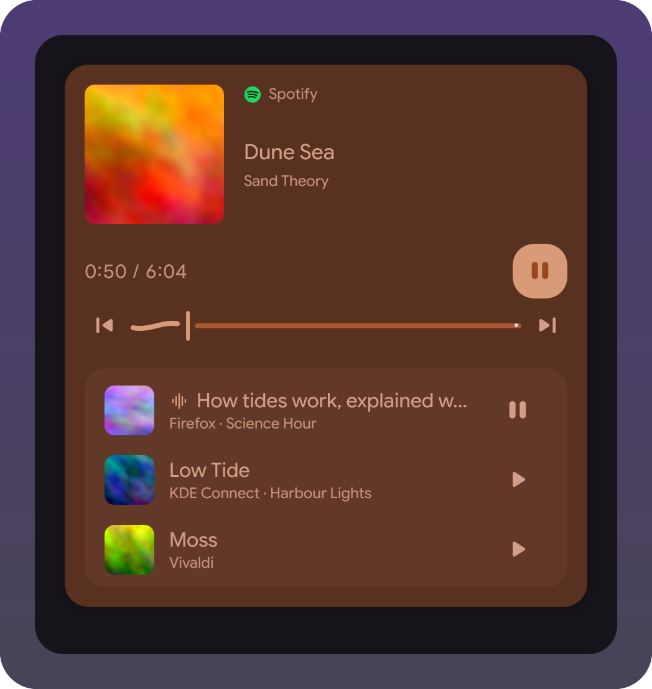

# Player widget

Media popup for the [illogical-impulse extensions
fork](https://github.com/Berupor/dots-hyprland-extensions). It takes the
`mediaView` slot, so the popup that opens from the bar's media pill shows this
instead of one card per player.

The active player gets the big card; every other player is a row under it. Click
a row to bring that player forward: it also becomes the shell's tracked player, so
the bar follows it once nothing else is playing. The button at the end of a row
plays or pauses that player without bringing it forward.

The card follows the shell's own player cards: it is tinted from the cover and
falls back to the wallpaper colors when there is no cover.

## Install

Paste the repo url on the Widgets page. Needs contract 1.10 (`mediaView`).
Remote covers are fetched with `curl` into the shell's cover cache, the same one
the built-in popup uses.

## Files

| File | What it is |
|---|---|
| `MediaView.qml` | slot entry: picks the hero player |
| `hero.js` | which player goes up front |
| `HeroView.qml` | the card, fed plain lists so the demo can drive it |
| `PlayerArt.qml`, `CoverArt.qml` | cover with a fallback glyph, remote art cached to a file |
| `CoverTint.qml` | color scheme off the cover, mixed like the shell's player cards |
| `demo/DemoPlayer.qml` | stub players for the checks and the shots in `docs/` |
